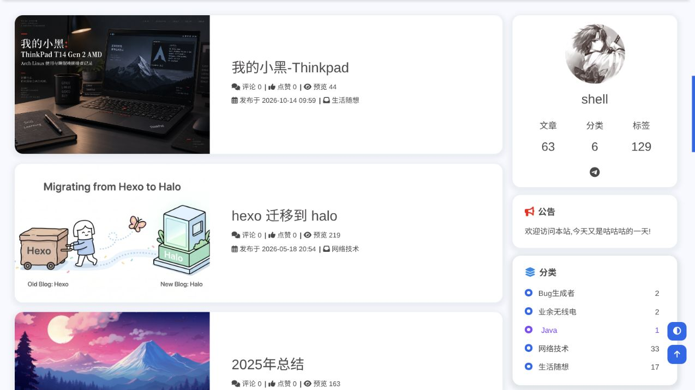
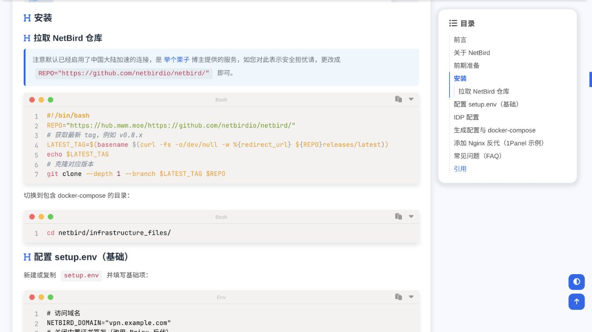
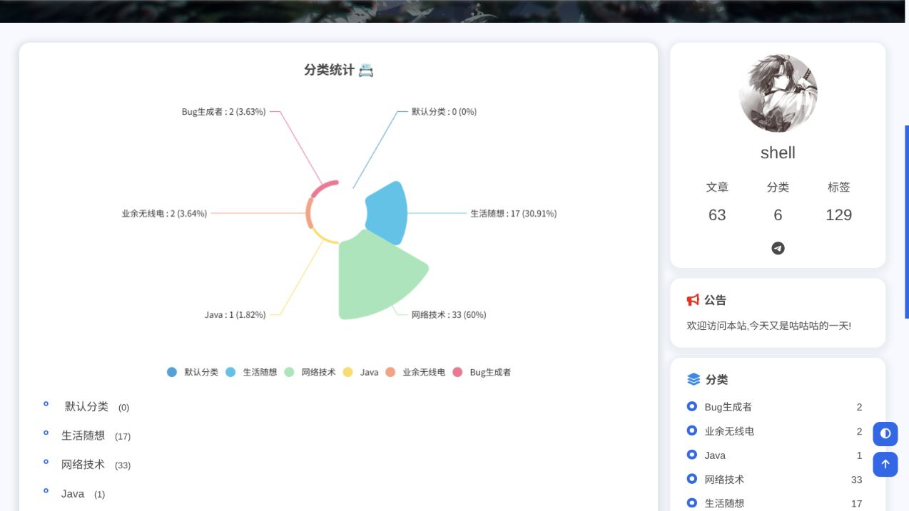

# Butterfly-shell 🦋

面向 Halo 2.x 的 Butterfly 卡片式博客主题，由 shell 持续重构与维护，兼顾博客阅读、移动端体验和资源加载性能。

[博客预览](https://blog.ning.moe/) · [下载发行版](https://github.com/biliblihuorong/halo-theme-butterfly/releases) · [配置文档](docs/configuration.md) · [更新记录](docs/releases/)

[](https://blog.ning.moe/)

预览截图取自[某科学的贝壳的博客](https://blog.ning.moe/)（2026-10-15），使用站点真实的文章、封面、作者信息与分类数据。

<details>
<summary>更多实景：首页首屏、文章目录与代码块、分类统计</summary>

首页首屏：

[](https://blog.ning.moe/)

文章目录与代码块，来自《使用 Netbird 轻松组建内网》：

[](https://blog.ning.moe/posts/netbird-private-network)

分类统计：

[](https://blog.ning.moe/categories)

</details>

本项目是由 shell 维护的**社区派生版本**，不代表 Halo 官方、Halo 移植版上游维护者或 Hexo Butterfly 原作者。项目 fork 自 [dhjddcn/halo-theme-butterfly](https://github.com/dhjddcn/halo-theme-butterfly) 的 v2.0.7，视觉与交互源于 Jerry 的 [Hexo Butterfly](https://github.com/jerryc127/hexo-theme-butterfly)。在 Halo 移植版的基础上，持续调整页面布局、主题配置、图片加载、代码高亮、评论与插件页面。

派生基点、[上游市场页面](https://www.halo.run/store/apps/app-UeCsJ)、具体差异、贡献状态与维护流程见[派生与应用市场说明](docs/marketplace.md)。

## 主要能力

- Butterfly 卡片布局、首页列表或平铺、首屏大图与打字机文案，适配桌面和移动端。
- 浅色、深色、按时间自动切换与访客手动切换，尊重系统的“减少动态效果”设置。
- 简繁文字切换、桌面宽屏阅读和评论快捷入口，阅读偏好保存在访客浏览器。
- 文章目录、阅读字数与时长、版权区、图片灯箱和返回顶部。
- 原生图片懒加载、失败回退，以及可选的图床预览图渐进加载。
- 内置按需加载的 Prism 代码高亮，支持行号、复制、折叠与深浅色代码主题；跳过 `shiki-code` 容器中的代码块。
- 归档、分类和标签统计图，支持 Artalk 或 Halo 评论组件及 Umami 公开分享统计。
- 适配友链、瞬间、图库、朋友圈、Steam 游戏库和 B 站追番插件页面，提供自定义 404/500 页面。

各页面的配置与支持范围见[配置文档](docs/configuration.md)。普通独立页面使用通用侧栏，不显示文章目录。Hexo Butterfly 的命令、配置文件和标签外挂不能直接用于本主题。

## 安装

主题元信息声明要求 Halo `>= 2.0.0`，使用现代浏览器；插件需满足各自的版本要求。安装发行包无需本地 Node.js 环境。

1. 从[发行版页面](https://github.com/biliblihuorong/halo-theme-butterfly/releases)下载 `theme-butterfly-dist.zip`。
2. 在 Halo Console → 外观 → 主题中上传安装，启用 **Butterfly-shell**。
3. 在主题设置中填写真实的“作者用户名”，并将静态资源来源保持为默认的“本站”。
4. 在外观 → 菜单中设置主菜单，再按需安装插件、添加对应页面入口。

升级或设置项缺失时，在主题详情页的 `···` 菜单执行“重载主题配置”。请使用发行包安装，GitHub 的源码 ZIP 不包含运行所需的 `templates/`。

从 **v2.3.4** 起，本分支使用独立标识 `theme-butterfly-shell`，避免与上游主题冲突。v2.3.3 及以前的 `theme-butterfly` 需要先安装新主题、迁移配置再启用，不能直接在旧主题上点“升级”；操作见[标识迁移说明](docs/configuration.md#从旧主题标识迁移到-v234)。文章、菜单和页面内容无需重建。迁移或升级前请保留原安装包与配置备份，出现问题时按[回退步骤](docs/configuration.md#回退到升级或迁移前的版本)恢复。

内置 npm CDN 地址不能保证提供本 fork 的对应资源。需要 CDN 时，请使用自定义地址托管同版本的完整主题资源；后台菜单与社交图标也受内置 Font Awesome 子集范围限制，具体方法见文档。

## 文档与更新

| 文档 | 内容 |
| --- | --- |
| [配置与使用](docs/configuration.md) | 安装、完整主题设置、页面路由、插件、配置迁移和常见问题 |
| [开发与构建](docs/development.md) | 开发环境、源码结构、资源与图标维护、测试、打包和发布校验 |
| [版本更新记录](docs/releases/) | 各版本新增功能、修复与升级说明 |
| [派生与应用市场说明](docs/marketplace.md) | 上游基点、差异与贡献方向、维护计划、上架材料及待完成人工验收 |

反馈问题时，请附上主题版本、Halo 版本、相关插件版本，以及可复现的页面或操作步骤：[提交 Issue](https://github.com/biliblihuorong/halo-theme-butterfly/issues)。

## 本地开发

需要 Node.js `>=22.13.0` 和 pnpm `11.20.0`。首次启动先构建，再监听源码变化：

```bash
pnpm install --frozen-lockfile
pnpm build
pnpm dev
```

交付前执行：

```bash
pnpm test
pnpm build-zip
```

安装包输出为根目录下的 `theme-butterfly-dist.zip`，同时生成 SHA-256 和 manifest 校验文件。开发细节与浏览器验证要求见[开发文档](docs/development.md)。

## 许可证与致谢

本主题遵循 [GPL-3.0](LICENSE) 开源协议。分发与二次开发时请保留许可证及原作者署名；第三方资源保留各自许可，详见[字体来源声明](src/font/THIRD_PARTY_NOTICES.md)和 [Font Awesome 说明](src/plugins/fontawesome/README.md)。

- Butterfly 原作者：[Jerry](https://github.com/jerryc127)
- Halo 移植基础：[小红 / dhjddcn](https://github.com/dhjddcn)
- 当前维护：[shell](https://github.com/biliblihuorong)
- 原版视觉参考与使用文档：[Butterfly](https://butterfly.js.org/)
